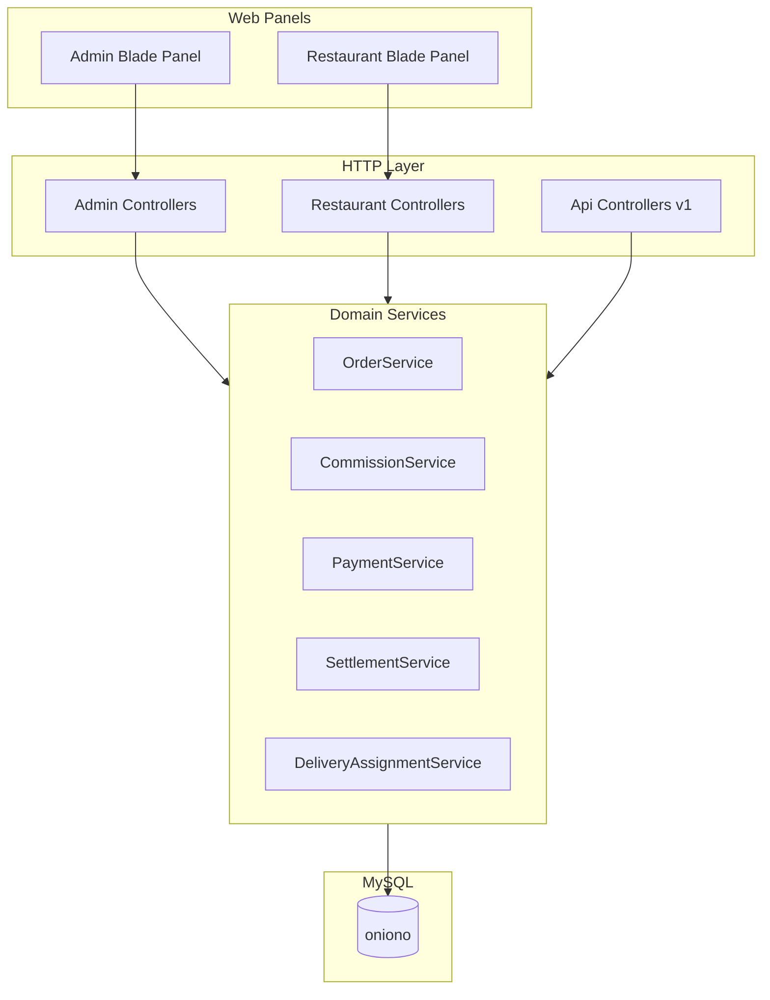
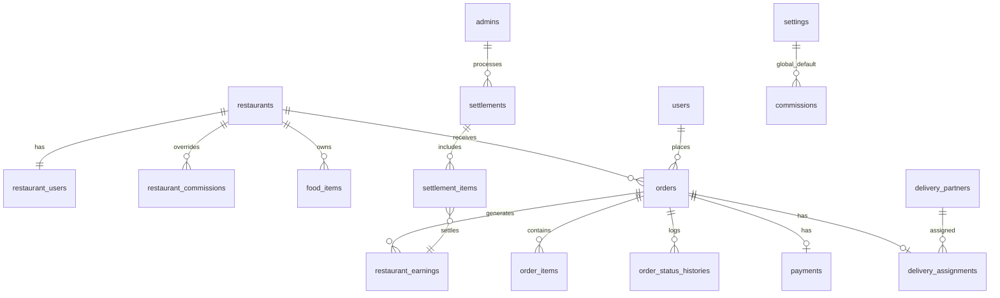
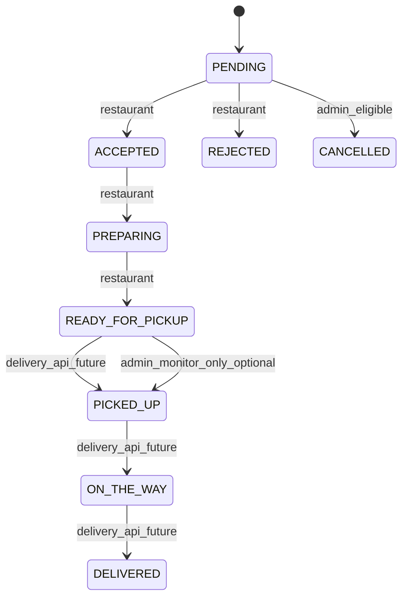

# Oniono Multi-Vendor Food Delivery — Technical Plan

## 1. Current environment (inspection summary)

| Item | Status |
|------|--------|
| PHP | **8.2.12** (XAMPP) |
| Laravel | **12.71.0** |
| Database | `.env` → **MySQL** `oniono` @ `127.0.0.1:3306`, user `root`, empty password |
| App code | **Skeleton only**: default `User`, 3 default migrations, single `welcome` view |
| Frontend stack | **Vite + Tailwind 4** (default Laravel 12) — spec requires **Bootstrap 5 + jQuery** for panels |
| Routes | Only `/` in [`routes/web.php`](routes/web.php); **no `routes/api.php`** registered in [`bootstrap/app.php`](bootstrap/app.php) |
| Business modules | **None** yet |

**Setup note:** `database/database.sqlite` exists from the Laravel installer, but `.env` points to MySQL. Use XAMPP MySQL (create DB `oniono` in phpMyAdmin if missing). MySQL CLI is not on PATH; use XAMPP’s `mysql.exe` or phpMyAdmin for verification.

**Do not delete** existing migrations or data; extend schema with new migrations only.

---

## 2. High-level architecture



**Principles**

- Controllers stay thin; **all money, commission, status transitions, settlement eligibility** live in services under `app/Services/`.
- **Enums** for order status, payment status, settlement status, restaurant registration status (`app/Enums/`).
- **Policies** + middleware on every restaurant-scoped action; `restaurant_id` always from `auth('restaurant')->user()->restaurant_id`, never from request input.
- **API v1** reuses the same services; add `routes/api.php` and Sanctum (or token guard) in a later sub-phase of Phase 10.

---

## 3. Authentication architecture

Three session guards (separate login URLs, separate user tables):

| Guard | Model / table | Login route | Middleware alias |
|-------|----------------|-------------|------------------|
| `admin` | `Admin` / `admins` | `/admin/login` | `auth:admin`, `admin.active` |
| `restaurant` | `RestaurantUser` / `restaurant_users` | `/restaurant/login` | `auth:restaurant`, `restaurant.approved` |
| `web` (future customers) | `User` / `users` | API only initially | `auth:sanctum` |

**Restaurant access rules**

- Registration → status `pending` → no dashboard access until `approved`.
- `rejected` / `suspended` → login blocked with clear message.
- **One account = one restaurant:** unique `restaurant_users.restaurant_id` (one login row per restaurant).

**Admin bootstrap:** seeder creates first super admin (env-driven credentials in local only).

**Password reset:** separate brokers in [`config/auth.php`](config/auth.php) for `admins` and `restaurant_users`.

Register route groups in [`bootstrap/app.php`](bootstrap/app.php):

- `web.php` → prefix groups `admin/*`, `restaurant/*`
- `api.php` → prefix `api/v1/*` (stub routes early, flesh out in Phase 10)

---

## 4. Route map (aligned with your spec)

**Admin** (`routes/admin.php` required from `web.php`):

- Auth: login, logout, forgot password
- Dashboard, restaurants, users, categories, food-items, delivery-partners, orders, delivery-assignment, payments, commissions, settlements, coupons, banners, reviews, notifications, support, reports, settings

**Restaurant** (`routes/restaurant.php`):

- register, login, logout, forgot password
- dashboard, profile, timings, categories (read-only global + own menu categories if needed), menu, orders, earnings, settlements, reviews, notifications, support, settings

**Naming:** `admin.orders.index`, `restaurant.orders.show`, etc.; RESTful resource routes where possible.

---

## 5. Database design (ER overview)

Core relationship sketch (39+ tables as per spec; implement in **ordered migrations** to satisfy FK dependencies):



**Critical columns on `orders` (financial snapshot — never recalc from current settings):**

- `food_subtotal`, `discount_amount`, `tax_amount`, `delivery_charge`, `packaging_charge`, `grand_total`
- `commission_percentage_applied`, `commissionable_amount`, `commission_amount`, `restaurant_earning_amount`
- `payment_method` (ONLINE | COD), `payment_status`
- `status` (workflow enum)

**Commission resolution** (stored at order placement / acceptance — document exact trigger in `CommissionService`):

```
IF active restaurant_commissions row for restaurant THEN use it
ELSE use settings.default_commission_percentage
```

**Settlement integrity:** `settlement_items` unique on `restaurant_earning_id`; create settlement inside DB transaction; mark earnings `settled_at` / link to settlement.

**COD:** extend `payments` (or `cod_collections`) with collection/remittance/reconciliation fields; separate from settlement.

**Indexes:** `orders(restaurant_id, status, created_at)`, `orders(user_id)`, `food_items(restaurant_id)`, `restaurant_earnings(restaurant_id, settled_at)`.

**Soft deletes:** categories, food_items, coupons, banners — **not** orders/payments/settlements.

---

## 6. Order status workflow (server-enforced)



**Phase 4 scope:** restaurant transitions through `READY_FOR_PICKUP`; admin **manual** `delivery_assignments`; delivery partner transitions stubbed in API for Flutter later.

Every transition → `order_status_histories` row (actor type, actor id, from/to, note).

---

## 7. UI / design system (WeEats-style, branded Oniono)

Replace panel frontend dependency on Tailwind with **Bootstrap 5** for admin/restaurant only (keep Vite for bundling optional panel JS/CSS, or CDN + `public/assets` for faster Phase 1).

**Layout components** under `resources/views/components/` and `resources/views/layouts/`:

- `layouts/admin.blade.php` — left sidebar (~260px), light gray `#F5F6FA` page background, white cards `rounded-4 shadow-sm`
- `layouts/restaurant.blade.php` — same shell, accent strip or sidebar tone to distinguish panel
- Sidebar: logo (green circle + utensil icon), user card (avatar, name, role, settings link), grouped nav (main + “Others”)
- Top bar: page title, centered search (orders/restaurants global search Phase 2+), notification bell
- Reusable: `x-stat-card`, `x-chart-card`, `x-data-table`, `x-status-badge`, `x-percent-pill` (+ green/red trend)

**Admin dashboard** (match reference layout):

1. **Top strip card:** Total Restaurants | Total Revenue | New Customers — with month-over-month % from SQL (not hardcoded).
2. **Row 2:** Order Analytics line chart (Chart.js) with vendor/status/period filters; Order Performance **radial** stats (completed / return / cancel rates); Revenue area chart.
3. **Bottom:** “Order Activities” DataTables — columns as mockup; server-side AJAX endpoint; export hooks (Phase 9).

**Libraries:** Bootstrap 5.3, Bootstrap Icons, jQuery 3.7, DataTables BS5, Chart.js 4, SweetAlert2 or Bootstrap toasts for feedback.

**Currency:** display **₹** per spec (mockup `$` is visual reference only).

---

## 8. Application folder structure (target)

```
app/
  Enums/
  Http/
    Controllers/Admin/
    Controllers/Restaurant/
    Controllers/Api/V1/
    Middleware/EnsureRestaurantApproved.php, EnsureAdmin.php
    Requests/Admin/..., Restaurant/...
  Models/          (Admin, Restaurant, RestaurantUser, Order, ...)
  Policies/
  Services/
    OrderService.php
    CommissionService.php
    Payment/RazorpayGateway.php
    Payment/CodPaymentHandler.php
    SettlementService.php
    DeliveryAssignmentService.php
  View/Components/  (optional Blade components)
database/migrations/   (domain batches)
database/seeders/      (AdminSeeder, DemoSettingsSeeder)
resources/views/
  layouts/
  admin/
  restaurant/
  components/
routes/
  web.php, admin.php, restaurant.php, api.php
```

---

## 9. Phase-wise roadmap (implementation after approval)

### Phase 1 — Foundation
- MySQL connectivity check; run existing migrations on `oniono`
- Add `admins`, guards, admin login, admin layout shell (Oniono theme)
- Add `restaurants`, `restaurant_users`, guards, restaurant register/login shells
- Middleware, policies scaffold, `settings` table + default commission key
- **Deliverable:** both panels login + empty dashboard with real layout

### Phase 2 — Restaurant lifecycle
- Registration form (all fields + document uploads to `storage/app/public`)
- Admin: list/approve/reject/suspend, commission override UI, profile view
- Restaurant: profile edit, verification status (read-only)
- **Deliverable:** end-to-end registration → approval

### Phase 3 — Catalog
- Global `categories`, `cuisines`; restaurant `food_items`, variants, add-ons
- Admin global category/cuisine CRUD; admin food oversight; restaurant menu CRUD scoped by `restaurant_id`
- **Deliverable:** restaurant can manage menu; admin can browse all items

### Phase 4 — Orders & delivery
- `orders`, `order_items`, status service + histories
- Restaurant order board (accept/reject/prepare/ready)
- Admin order list/filters/detail; `delivery_partners` CRUD
- **Manual** delivery assignment UI + `delivery_assignments` + history
- **Deliverable:** simulated order flow through ready-for-pickup + assignment

### Phase 5 — Commission & earnings
- Global + per-restaurant commission admin screens
- `CommissionService` on order; `restaurant_earnings` ledger
- Admin + restaurant earnings views
- **Deliverable:** order shows frozen commission; ledger matches formula

### Phase 6 — Payments
- `payments`, `transactions`; Razorpay order create + signature verify + webhooks
- COD flags and collection tracking (admin reconciliation screens basic)
- **Deliverable:** online test payment + COD order path

### Phase 7 — Settlements
- Admin: pending by restaurant, select eligible earnings, create settlement, mark paid
- Restaurant: settlement history read-only
- Transactional anti-double-settle
- **Deliverable:** full manual settlement audit trail

### Phase 8 — Marketing & engagement
- Coupons, banners, reviews, notifications, support tickets
- **Deliverable:** CRUD + panel integration

### Phase 9 — Reports, CMS, settings
- Sales/order reports, exports, static pages, platform settings (brand, COD toggle, default commission)
- Admin dashboard charts wired to live aggregates
- **Deliverable:** dashboard matches mockup with real data

### Phase 10 — Hardening & API readiness
- Feature tests: restaurant isolation, commission snapshot, settlement concurrency
- `api/v1` resource controllers (auth, restaurants, menu, cart/checkout stubs, orders read, delivery partner stubs)
- Sanctum install, API documentation outline
- Deployment checklist (XAMPP / production)

---

## 10. Key packages (Composer / NPM)

| Purpose | Choice |
|---------|--------|
| Online payments | **razorpay/razorpay** (first gateway; wrap in `PaymentService` interface) |
| Excel export (Phase 9) | `maatwebsite/excel` (optional) |
| API auth (Phase 10) | `laravel/sanctum` |
| Images | Laravel filesystem + intervention optional later |

Panels: Bootstrap/jQuery/DataTables/Chart.js via NPM or CDN (decision at Phase 1 start — prefer NPM + Vite `resources/js/admin.js` for consistency).

---

## 11. Technical risks & mitigations

| Risk | Mitigation |
|------|------------|
| Restaurant IDOR | Policy on every model; query global scopes; FormRequests never accept `restaurant_id` from restaurant panel |
| Commission drift | Snapshot columns on `orders`; settings changes only affect new orders |
| Double settlement | DB transaction + unique `settlement_items.restaurant_earning_id` |
| COD vs settlement confusion | Separate statuses and admin screens; document in UI labels |
| Multi-guard sessions | Test login/logout across guards; use guard-specific `auth()->guard()` in controllers |
| Large migration batch | Split migrations by domain (core → catalog → orders → finance) |
| Tailwind vs Bootstrap conflict | Scope Tailwind to welcome/landing only, or remove from panel bundle |

---

## 12. Local development setup (XAMPP)

1. Start **Apache + MySQL** in XAMPP.
2. Create database **`oniono`** (utf8mb4_unicode_ci).
3. Confirm [`.env`](.env) `DB_*` matches XAMPP (already set).
4. `composer install` (done), `php artisan migrate`, `php artisan storage:link`.
5. `npm install` && `npm run build` (or `npm run dev` during UI work).
6. `php artisan serve` or virtual host → `http://localhost/oniono/public` (your preference).
7. Seed admin: `php artisan db:seed --class=AdminSeeder`.

**Razorpay:** add `RAZORPAY_KEY`, `RAZORPAY_SECRET`, webhook secret to `.env` when testing Phase 6.

---

## 13. First implementation slice (after you approve this plan)

Start **Phase 1** only:

1. Migration batch: `admins`, `restaurants`, `restaurant_users`, `settings`
2. Configure guards in [`config/auth.php`](config/auth.php)
3. Admin + restaurant auth controllers and views
4. Oniono-themed admin dashboard blade (static layout + zeroed stats from DB counts where tables exist)
5. Register `admin.php` / `restaurant.php` route files

No order/payment logic until Phases 3–6.
